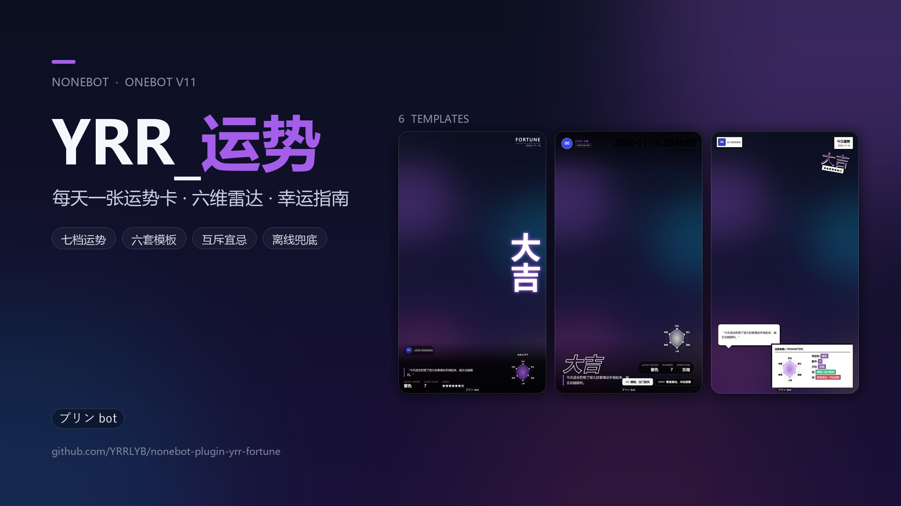
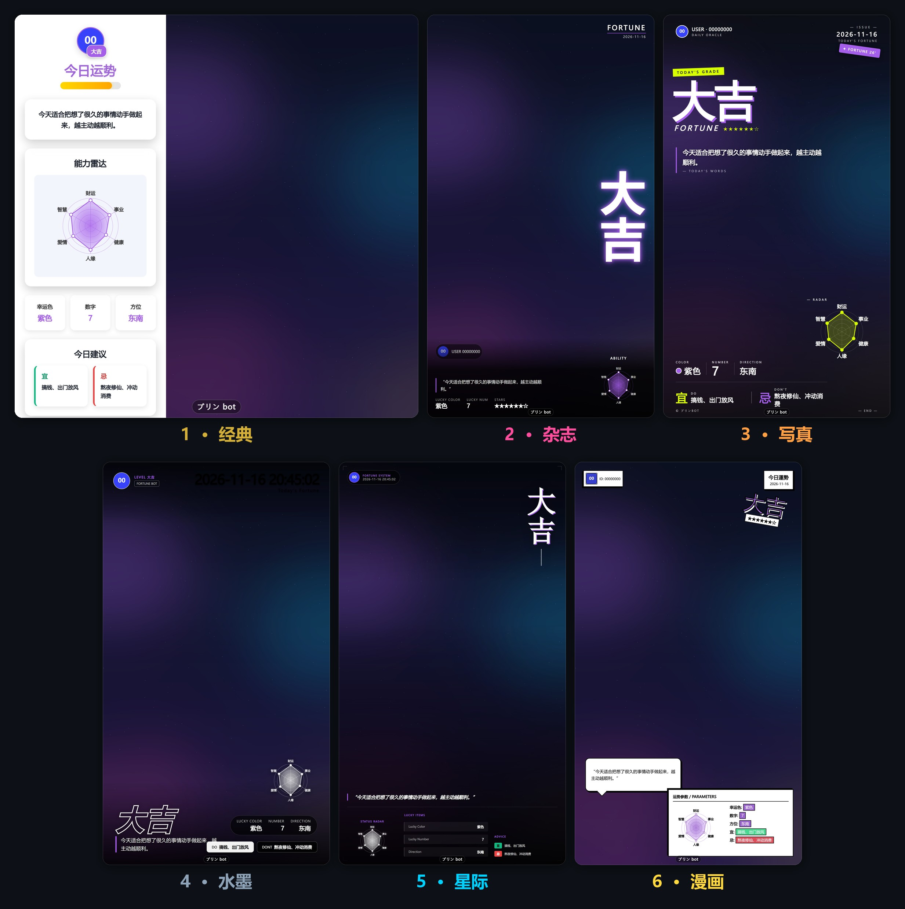

# YRR_运势 (`nonebot-plugin-yrr-fortune`)

> 每天一张高颜值运势卡片：七档运势、六维雷达、幸运指南与智能互斥宜忌，内置六套风格迥异的渲染模板，支持背景图提取与离线兜底。

本插件拆离自作者自用的 QQ 机器人 **プリン (布丁)** 的核心娱乐模块，经过解耦与重构后作为独立插件开源。



> 展示图中的 QQ 号、头像和背景均为生成的演示数据，不含真实用户信息。

## 特性一览

- **今日运势锁定**：每天 0 点准时刷新，当天重复触发结果保持一致（拒绝赛博改命，顺便省点算力）。
- **七档运势评级**：`大凶` / `小凶` / `末吉` / `小吉` / `中吉` / `大吉` / `天命`，精准拿捏今日欧非程度。
- **六维属性雷达**：财运、事业、健康、人缘、爱情、智慧，全方位量化你的今日状态。
- **智能互斥宜忌**：内置维度冲突校验，同一维度绝不同时出现在「宜」和「忌」里，彻底告别「宜早睡、忌熬夜」式人工智障矛盾。
- **六套主题模板**：经典、杂志、写真、水墨、星际、漫画，支持群友按个人喜好独立切换并持久化保存。
- **专属水印**：每张卡片底部带「プリン bot」署名。
- **背景原图提取**：遇到心动的卡片背景？直接回复运势图发送 `/背景图` 即可捞出无水印原图。
- **离线兜底**：背景接口或头像下载失败时自动使用内置渐变与占位头像，照样出图。

## 安装

使用 `nb-cli` 安装（推荐）：

```bash
nb plugin install nonebot-plugin-yrr-fortune
```

或者通过 `pip` 直接安装：

```bash
pip install nonebot-plugin-yrr-fortune
```

> **依赖提示**：本插件依赖 `nonebot-plugin-htmlrender` 进行卡片渲染。如果是首次部署，请务必确保宿主机的 Playwright Chromium 已安装到位，否则渲染时会直接报错给你看：
> ```bash
> playwright install chromium
> ```

## 指令

| 指令 | 说明 | 权限 |
| --- | --- | --- |
| `运势` / `今日运势` | 抽取并生成今日运势卡片 | 所有人 |
| `运势模板` | 查看六套主题模板总览图 | 所有人 |
| `运势模板 1-6` | 切换个人专属运势模板（如 `运势模板 2`） | 所有人 |
| `/背景图` / `/运势背景图` | 回复某张运势图可提取对应原图；直接发送则随机抽取一张 | 所有人 |
| `/重置运势` | 清空所有人的今日运势缓存（需二次回复 `y` 确认） | 群管 / 群主 |

## 模板



| 编号 | 名称 | 视觉风格 |
| :---: | --- | --- |
| `1` | 经典 | 典雅暖金质感，经典耐看百搭款 |
| `2` | 杂志 | 拍立得 / 杂志排版风，清爽通透 |
| `3` | 写真 | 光影人像海报，氛围感拉满 |
| `4` | 水墨 | 传统东方留白意境，国风质感 |
| `5` | 星际 | 科幻战术 HUD 面板，硬核极客最爱 |
| `6` | 漫画 | 漫画分镜叙事布局，二次元浓度超标 |

## 配置

所有配置项均已内置合理默认值，**零配置即可开箱即用**。如需自定义背景图接口或调整缓存策略，请在 `.env` 文件中按需覆盖：

```dotenv
# 背景图 API 地址（sort=mp 为国内手机竖屏线路，直接返回图片二进制字节流）
FORTUNE_BACKGROUND_URL=https://photo.yrrlyb.top/api.php?sort=mp

# 后台预加载背景图队列数量，默认 8 张，设为 0 则关闭预加载
FORTUNE_PRELOAD_COUNT=8

# 拉取背景图的 HTTP 超时时间（秒）
FORTUNE_HTTP_TIMEOUT=30

# 内存中保留的运势消息映射上限（用于 /背景图 回复溯源），默认 500 条
FORTUNE_MAX_MESSAGE_MAP=500

# 是否跳过 TLS 证书校验（仅在自建图床证书异常时开启，默认严格校验）
FORTUNE_INSECURE_SSL=false
```

> 旧版 `BACKGROUND_IMAGE_URL` 已弃用，请改用 `FORTUNE_BACKGROUND_URL`；只写旧变量时插件会忽略它并给出日志提示。

### 存储路径说明

插件数据与缓存统一交由 `nonebot-plugin-localstore` 规范管理：

- **用户数据**：`get_plugin_data_dir()/user_data.json`
- **图片缓存**：`get_plugin_cache_dir()/backgrounds` 与 `/avatars`
- **自定义字体**：`数据目录/fonts/msyh.ttc`（若未放置则自动回退至系统默认字体）

> **平滑升级**：如果你是从旧版 `data/YRR_database/user_data.json` 迁移而来，插件在首次启动时会自动完成历史用户数据迁移，无需手动搬运。

## 兼容性

- **NoneBot2**：`2.2.0+`
- **适配器**：OneBot V11
- **Python**：`3.9+`

## 开发与魔改

如果你想在本地二次开发或微调卡片样式：

```bash
pip install -e .
python -m unittest discover -s tests -v
```

> **改模板避坑提示**：HTML 模板位于 `nonebot_plugin_yrr_fortune/templates/*.html`，底层采用 Python 原生 `str.format` 进行变量注入。手动修改 CSS 样式时，所有的花括号必须写成双写转义形式（`{{` 和 `}}`），否则渲染时会直接触发 `KeyError` / `ValueError`。

> **关于底部水印**：六套内置模板的底部均保留了极小的 **プリン bot** 标识，作为本插件出自 **プリン (布丁)** 的溯源印记。如果你基于本项目进行二次开发或魔改模板，希望能顺手保留这个小小的角标，感谢对原作者的尊重。

## 许可

本项目基于 [MIT](LICENSE) 协议开源。欢迎提 Issue 反馈问题，或者直接提 PR 一起折腾。
